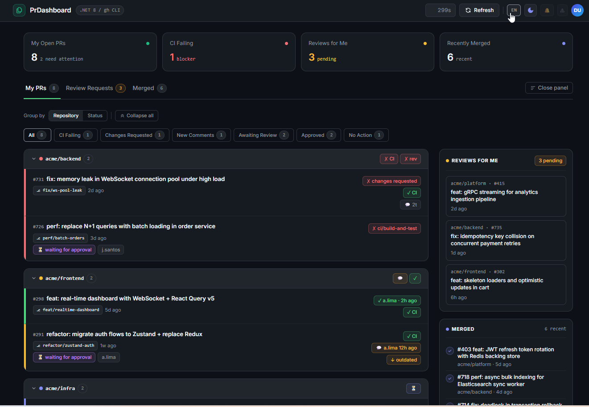

# PrDashboard

A self-hosted Windows dashboard for GitHub pull requests. Runs a local web UI on `localhost:5555` that shows your open PRs, incoming review requests and CI status — with live auto-refresh, audio notifications, and Markdown standup reports.

Built out of a personal need: working across many different repositories at once, GitHub's own interface never felt right for keeping track of everything — and following PRs by email is even worse. This tool gives a single focused view of what actually needs attention.



## Download

Grab the latest build from the [**Releases**](../../releases) tab — no .NET runtime required.

| File | Description |
|------|-------------|
| `PrDashboard-vX.X.X.zip` | Standard — connects to GitHub via `gh` CLI |
| `PrDashboard-demo-vX.X.X.zip` | Demo mode — fake data, no GitHub auth needed |

## Requirements

- Windows 10/11 x64
- [GitHub CLI (`gh`)](https://cli.github.com) on PATH, authenticated via `gh auth login`

## Quick Start

```
1. Extract the ZIP anywhere
2. Run PrDashboard.exe
3. Open http://localhost:5555
```

The dashboard auto-refreshes every 5 minutes (configurable).

## Configuration (`config.json`)

```json
{
  "intervalSeconds": 300,
  "outputDir": "./out",
  "cacheDir": "./cache",
  "historyDays": 30,
  "hostname": "github.com",
  "ignoredOrgs": [],
  "ignoredRepos": ["org/noisy-repo"],
  "hideDrafts": false,
  "visibleColumns": ["repo","number","title","review","ci","comment","merge","age"]
}
```

| Field | Default | Description |
|-------|---------|-------------|
| `intervalSeconds` | `300` | Auto-refresh interval in seconds |
| `outputDir` | `./out` | Directory for Markdown reports |
| `cacheDir` | `./cache` | Directory for per-repo PR cache (JSON files) |
| `historyDays` | `30` | How many days back to fetch merged PRs |
| `hostname` | `github.com` | Override for GitHub Enterprise |
| `ignoredOrgs` | `[]` | Orgs to exclude |
| `ignoredRepos` | `[]` | Repos to exclude, e.g. `["org/repo"]` |
| `hideDrafts` | `false` | Hide draft PRs |

## CLI Flags

```
PrDashboard.exe                        # Web UI on http://localhost:5555
PrDashboard.exe --once                 # One refresh → save reports → exit
PrDashboard.exe --demo                 # Fake data, no GitHub API calls
PrDashboard.exe --interval 60          # Override refresh interval
PrDashboard.exe --hostname gh.corp.com # GitHub Enterprise host
PrDashboard.exe --help
```

## Demo Mode

Run `PrDashboard-demo.exe` (or `--demo`) to launch with fake data — useful for testing the UI without GitHub credentials.

## Standup Reports (`--once`)

Run with `--once` to generate Markdown files and exit — ideal for Windows Task Scheduler:

```
PrDashboard.exe --once
```

Output in `./out/`:

| File | Description |
|------|-------------|
| `standups/YYYY-MM/YYYY-MM-DD.md` | Daily standup snapshot — your open PRs with full context |
| `review-queue/YYYY-MM/YYYY-MM-DD.md` | PRs from others requesting your review |
| `prs/dashboard.md` | Overview table — open PRs, review requests, recent history |
| `prs/history.md` | Full merged and closed PR history |

Per-repo PR data is cached in `./cache/repos/` as JSON files and updated incrementally — only PRs with a changed `updated_at` are re-fetched from the GitHub API. Bot and CI comments (GitHub Actions, Dependabot, Copilot) are excluded from the cache.

## Audio Notifications

Place these files next to `PrDashboard.exe`:

| File | Plays when… |
|------|-------------|
| `message.mp3` | A new comment appears on one of your PRs |
| `error.mp3` | A CI failure is detected |

## Building from Source

Requires .NET 8 SDK.

```powershell
git clone https://github.com/OWNER/REPO
cd REPO
dotnet run --project PrDashboard
```

Publish self-contained `.exe`:

```powershell
dotnet publish PrDashboard -c Release -r win-x64 --self-contained true `
  -p:PublishSingleFile=true -p:IncludeNativeLibrariesForSelfExtract=true -o publish/
```

Run tests:

```powershell
dotnet test
```

## CI/CD

Every push to `main` triggers [`.github/workflows/release.yml`](.github/workflows/release.yml) on the self-hosted Windows runner:

1. Runs `dotnet test`
2. Publishes two builds: normal (`PrDashboard.exe`) and demo (`PrDashboard-demo.exe`)
3. Packages each as a `.zip`
4. Creates a GitHub Release tagged `vYYYY.MM.DD.{build_number}`

A release index page is served via GitHub Pages from the `docs/` folder.  
**Setup:** go to *Settings → Pages*, set source to `main` branch, `/docs` folder.

## Troubleshooting

**SSO/SAML error accessing an org:**
```
gh auth refresh -h github.com -s read:org
```
Then authorize SSO in the browser that opens.

**`GH_TOKEN` overriding the `gh` login:**
```powershell
Remove-Item Env:GH_TOKEN
```

**SmartScreen blocking the `.exe`:**
The binary is self-contained and unsigned. Click *More info → Run anyway*, or sign with a code-signing certificate.

**Window closes immediately on double-click:**
Run from a terminal to see the full error message.
